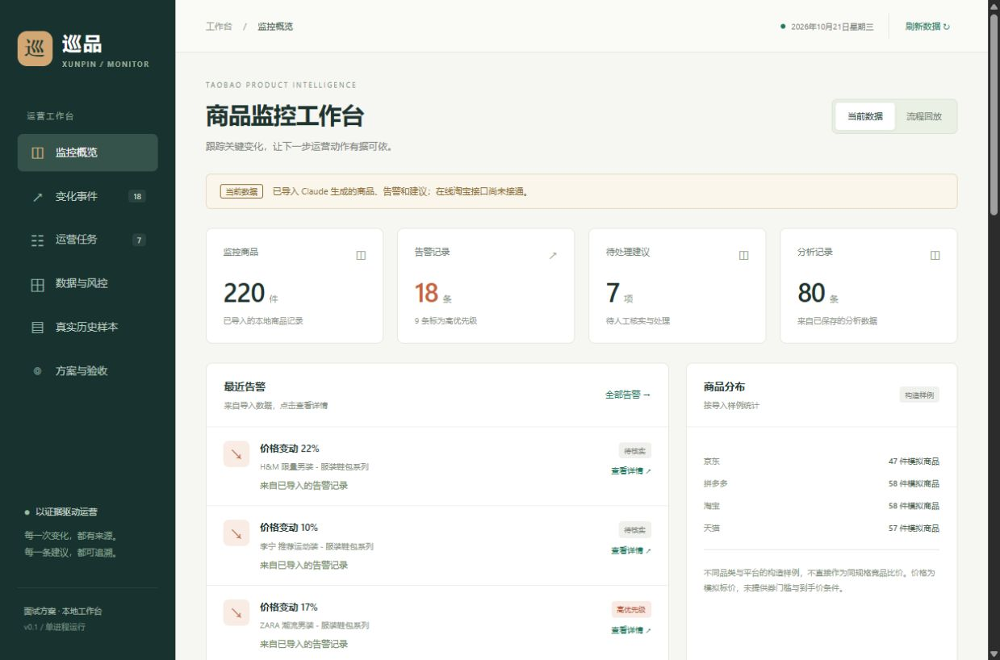
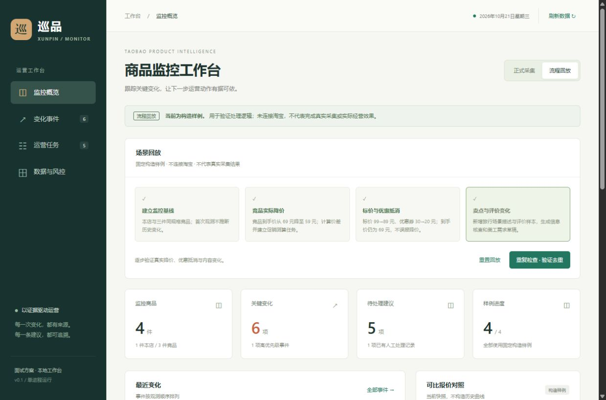
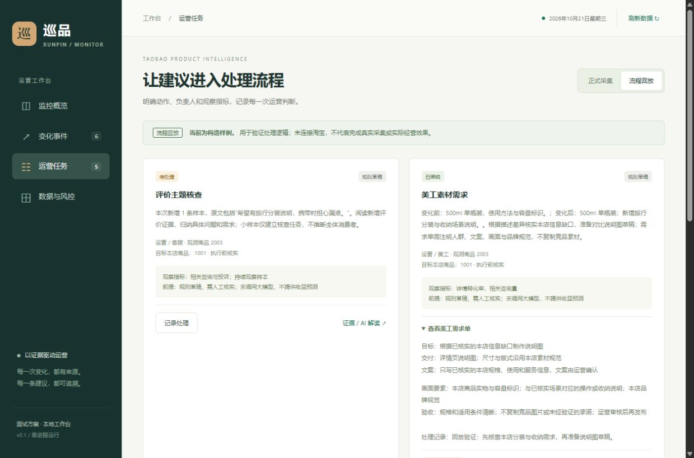
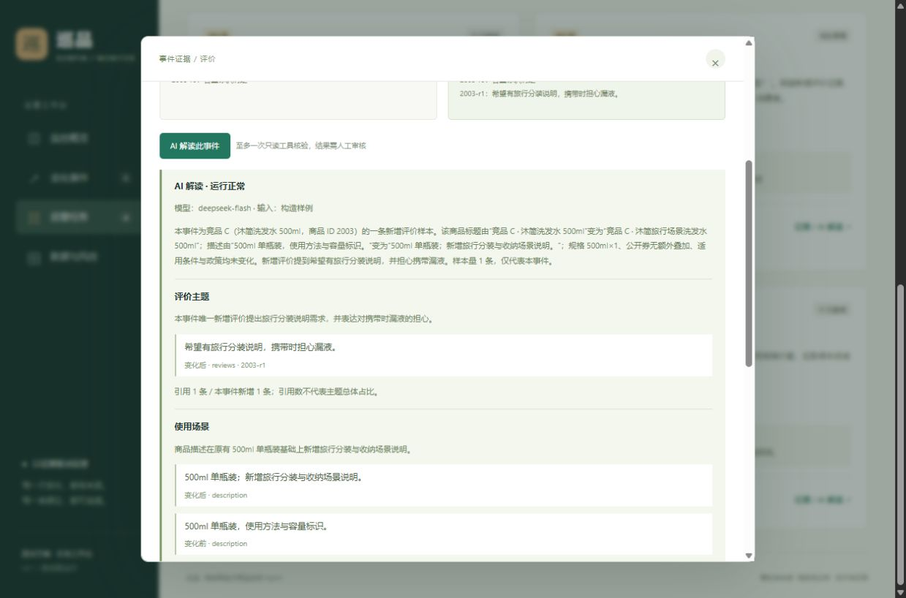
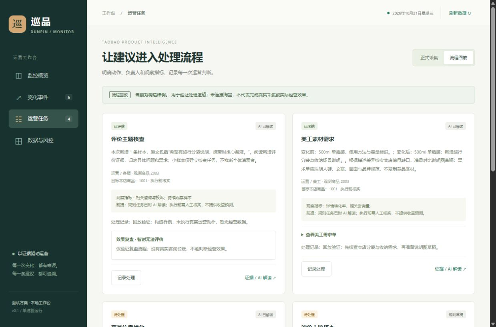

# 巡品 Xunpin

淘宝商品与竞品监控 Agent · 方案设计与本地演示

面向电商运营的本地监控工作台。支持商品快照、变化证据、运营任务、来源控制与独立调度；提供真实接口适配器和明确隔离的流程回放。**已从天池官方历史语料抽样接入200条真实标题/描述；真实文本的两次DeepSeek验证一条通过、一条回退。在线淘宝采集尚未接通。**

## 本地运行

公开版自带220个生成商品、18条告警、7条建议和80条分析，克隆后即可查看概览；不需要先配置模型或淘宝账号。API密钥、用户数据库、200条真实天池历史文案及其模型输出不随仓库分发，真实语料需按来源许可自行下载导入。已有本地导入优先于随仓库提供的示例。

Windows可直接双击根目录 `start.bat`，启动原巡品界面并自动打开浏览器；已有服务会复用。启动检查可运行 `start.bat --check`，端口冲突可用 `start.bat --port 8002`，不停止其他进程。

需要 Python 3.11+。在仓库根目录运行：

```powershell
uv sync --locked
uv run python run.py
```

访问 [本地工作台](http://127.0.0.1:8000)。没有 uv 时：

```powershell
python -m venv .venv
.venv\Scripts\python -m pip install -r requirements.txt
.venv\Scripts\python run.py
```

当前概览直接使用Claude已生成的本地数据，导入时源库已有220商品、18告警、7建议、80分析；保留原巡品UI，没有新增模拟模式。原始文件只读导入，不自动调用旧版随机分析。来源与审查见 [本轮审查](docs/claude-review.md)。

默认绑定本机，正式来源未配置时不会请求外部商品接口。可切换“流程回放”，依次建立基线、推进实际降价、优惠抵消和内容变化；构造样例只验证流程。

可选：复制 `.env.example` 到 `.env`，仅在取得权限并核实配额后配置来源。字段与服务端契约见 [接入契约](docs/provider-contract.md)。修改配置后重启服务。

```powershell
uv run pytest -q
uv run python -m evaluations.run --check --json artifacts/evaluation.json --markdown artifacts/evaluation.md
```

后端用标准库 SQLite，前端无 CDN 或构建依赖。`uv.lock` 固定依赖；测试覆盖签名、未授权不请求、调度、限频、退避、暂停、乱序、持久去重、证据及 API 流程。CI 配置已提供，远程尚未运行。

从侧栏“方案与验收”打开 [一页说明](http://127.0.0.1:8000/static/briefing.html)：业务目标、Agent分工、数据来源与四项要求的验收证据。该页数字为2026-10-21验证记录，可打印，不会触发采集或模型请求。当前已有回放分析和反馈，查看即可，重置会清除这些回放记录。

从侧栏或 [真实历史样本](http://127.0.0.1:8000/#history) 查看200条实际文案，支持分页、原始行号、文件哈希和保存的DeepSeek分析；刷新仍停留在样本页。这些记录不进入实时比价或变化事件。复现导入见 [历史样本说明](docs/history-data.md)，原始文件、样本库与真实文本输出不随代码分发。

## 界面











## 阅读顺序

1. [完整方案](docs/solution-design.md)：业务目标、数据来源、工作流程、AI 分工、运营建议、异常处理和效果评估。
2. [数据接入核验](docs/data-access.md)：官方资料、权限边界、接入步骤及当前未解决的条件。
3. [项目重构与展示计划](docs/showcase-plan.md)：原项目取舍、实施顺序、录屏和逐项验收标准。
4. [淘宝官方接入步骤](docs/taobao-onboarding.md)：当前仅有买家账号时的限制、联盟候选路径与所需账号检查。
5. [离线规则评估](artifacts/evaluation.md)：62 个固定构造案例、逐类指标和逐案例结果；[首轮失败结果](artifacts/evaluation-before.md)保留字段缺失误报。
6. [面试与录屏提纲](docs/interview-notes.md)：两分钟口述、当前可录的回放流程、追问和实际缺口。
7. [第三方来源调研](docs/third-party-data-research.md)：候选接口、接入门槛和仍待核实的来源许可。
8. [真实模型验证](docs/model-validation.md)：DeepSeek 配置、五类构造事件的调用记录、首轮失败与重试，以及语义评估限制。
9. [公开数据候选核验](docs/public-datasets.md)：Kaggle和天池实际筛选、字段与许可限制；[公开元数据记录](artifacts/public-dataset-metadata.json)不代表已下载数据集或已接通淘宝商品。
10. [正式来源字段与验收表](docs/access-acceptance.md)：本店/竞品覆盖、预算测算假设和真实三周期运行所需证据。

## 当前状态（2026-10-21）

| 项目 | 状态 |
| --- | --- |
| 题目要求与方案映射 | 已整理，见完整方案 |
| 官方资料与已下线接口核对 | 已核对公开资料；不等同于取得调用权限 |
| 原项目审查 | 已执行代码审查和内存数据库接口检查，问题见展示计划 |
| 淘宝应用、接口权限和商家授权 | 已看到官方测试应用及小程序基础权限，未验证到本项目所需的商品查询权限或商家授权 |
| 竞品授权数据服务 | 尚未选择，尚未核实数据权利和字段覆盖 |
| 真实历史文本 | 天池9717文件已下载；扫描2,129,187行，固定种子抽样200条；原始行号与SHA-256可追溯 |
| 真实文本模型验证 | 两条历史样本各一次DeepSeek请求：一条通过、一条回退；保留实际结果，不代表语义准确率 |
| 定时控制与来源适配器 | 已实现；通过本地 HTTP 契约和调度测试 |
| 快照、变化、证据、任务处理 | 已实现；回放与正式数据隔离，SQLite 持久化 |
| 模型调用与有界工具 | 已接通 DeepSeek；结构化语义发现、逐字引文、谨慎推测、行动与评估计划；最多两次请求和一次只读工具 |
| 模型真实调用验证 | 五类构造事件最终通过本地输出契约复核；首轮 4/5，促销一次受控重试后通过；不代表语义准确率 |
| 执行与效果复盘 | 人工填写日期、动作、指标单位、基线、结果、台账和干扰因素；无数据可说明无法评估；历史持久保存 |
| 在线采集与连续快照验证 | 尚未执行，不能宣称已满足定时真实获取验收；历史文本验证单独记录 |
| 新版本地工作台 | 已实现；构造场景可重复运行；不冒充真实市场数据 |
| 离线变化识别评估 | 62/62 构造案例通过；自动测试与真实模型验证范围见验证记录；不是独立标注、真实市场或大模型准确率 |

完整业务设计见方案文档。当前实现边界：官方适配器只覆盖自店标题、标价及返回的描述；促销、SKU 和评价需取得对应权限后扩展。竞品适配器采用本项目标准契约，尚无已选定并核准的数据服务。没有接入证明时，不能把演示过程表述为已完成题目第一项的真实运行验收。

原型定位为单进程、本地个人展示。执行锁和预算在该进程内串行化；不要使用多个 worker 或当作带用户权限系统的公网服务部署。任务状态是人工记录，不代表已在淘宝执行改价或发布。

## 核心决策

- 自店数据优先走具有相应权限的官方卖家接口。
- 竞品数据选择明确获准用于该业务场景的官方能力或授权服务，不假定卖家授权能读取任意竞品详情及评价。
- 每个字段记录来源、适用条件、数据时间和可用性。没有拿到的数据保持未知。
- 采集调度、限频、去重、价格计算由程序负责；AI 负责文本识别、变化解释和建议生成。
- 所有建议附证据并交运营处理；价格、商品发布和素材投放不由模型直接修改。
- 演示样例可以验证流程，但不能作为真实获取能力的验收证据。

原 Claude 项目仍保留在用户提供的目录中，本工作区未覆盖原文件。公开发布前应处理原代码来源、依赖、许可证和敏感信息，并以实际实现重新编写 README。
