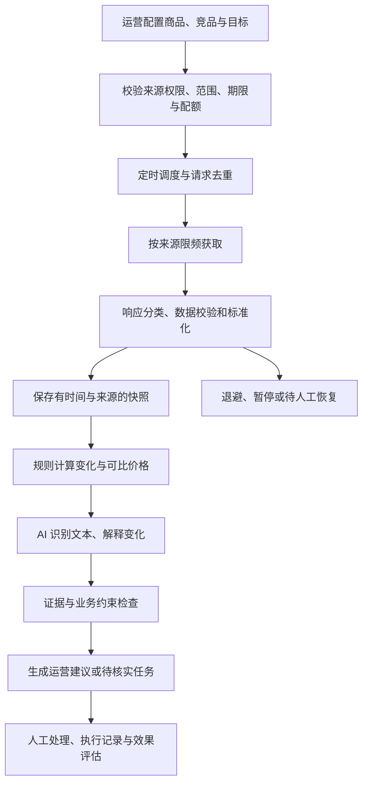

# 淘宝商品与竞品监控 Agent 方案设计

版本：2026-10-21 · 方案草案，用于讨论与面试准备

当前前提：尚无可用于本项目的官方应用权限或已核准的竞品数据服务。以下是目标设计，不是已上线系统说明。数据接入的证据与未验证条件见 [接入核验](data-access.md)。

配套交付：[来源字段与运行验收](access-acceptance.md)、[公开数据筛选](public-datasets.md)、[真实模型记录](model-validation.md) 和 [口述与演示顺序](interview-notes.md)。工作台提供说明页与200条 [真实历史文案](history-data.md)；真实模型已分析构造输入及历史真实文本，在线商品来源仍未接通。

## 1. 业务目标与使用场景

面向品牌店铺运营，每日跟踪本店重点商品及运营指定的直接竞品，减少手动检查和无效告警，把重要变化转换成可处理的任务。

第一阶段选择一个熟悉的品类，例如洗发水。业务规模假设为本店 5 个重点商品、20 个竞品链接，实际数量由权限、配额和运营需求决定。运营确认商品对应关系，不让模型自行把不同品类或不同规格认作直接竞品。

系统回答三个问题：哪些商品发生重要变化，证据是否足够，运营接下来应做什么。监控范围覆盖标题、描述、价格、促销及评价；各字段只有在来源允许、样本可用时才进入分析。

## 2. 数据来源与接入选择

| 对象与内容 | 接入路径 | 启用前条件 |
| --- | --- | --- |
| 本店商品标题、描述、规格及标价 | 官方商品接口，例如 `taobao.items.onsale.get` 配合 `taobao.item.seller.get` | 应用已获接口权限，商家完成授权，确认实际返回字段和更新语义 |
| 本店促销及评价 | 对应的官方授权能力，或商家获准提供的数据接口 | 逐项核验权限、优惠条件、评价时间窗与字段；不能假设商品接口自带全部内容 |
| 竞品公开标题、描述、规格、价格及促销 | 支持该场景的官方能力，或有明确数据来源和使用许可的授权服务 | 核实竞品监控用途、商品范围、字段、调用配额、留存及 AI 处理限制 |
| 竞品公开评价 | 明确覆盖评价的获准数据服务 | 实测评价正文、时间、分页或增量能力；取得样本范围与使用依据 |
| 本店成本、毛利目标、活动预算、品牌素材规范 | 企业授权的内部经营配置 | 用于约束建议；不向竞品数据源请求这些信息 |

这里的官方接口名称是待验证的接入候选。官方文档把 `taobao.item.seller.get` 标为需要授权，[来源见接口文档](https://developer.alibaba.com/docs/api.htm?apiId=24625&source=search)。当前会话用户的在售商品范围见 [官方列表接口](https://developer.alibaba.com/docs/api.htm?apiId=18)。这些资料不能证明本项目已拥有权限，也不能证明能覆盖任意竞品。

对竞品来源执行小规模接入验证：先拿到应用或服务商的适用场景证明和接口说明，再用 3—5 个指定商品验证字段与更新时间。任一必需字段不可用时，记录覆盖缺口；字段缺失不算变化，也不让 AI 补造。

若没有可用来源，正式采集任务保持未启用。若只能取得部分字段，可在界面说明范围后提供有限监控，但完整要求验收仍保留未通过项。人工导入和演示样例不替代定时真实获取。

## 3. Agent 工作流程

采用一个受约束的 Agent 配合工具，避免为展示拆出多个只有名称的 Agent。模型可在来源权限、缓存有效期和调用预算内选择读取商品快照、查询已批准的竞品对照、读取新增评价、创建建议草稿。允许一次补充核验；证据不足则输出待核实。

限频、权限和暂停判断在工具执行层强制执行，模型不能改写。采集服务独立定时运行，不依赖模型主动发起，不接受模型生成的任意网页地址。

## 4. 定时获取与数据标准化

初始调度建议：价格与促销每小时检查；标题和描述每日检查；评价每日增量同步。若数据源字段合并在同一接口返回，不为每个字段分别调用。来源更新周期更慢时同步降低检查频率；大促加频必须重新核对配额和许可。

例如 25 个商品每小时各调用一次详情接口，基础需求约为 600 次/日；这是容量估算，不是平台配额。还要加上评价分页、失败重试及核验请求，并留出预算余量。总量不足时减少商品范围或降频。

请求携带来源、接口方法、商品 ID、区域、SKU 和必要的价格适用上下文。不能比较不同会员身份、地区、件数或领取门槛下的报价。

统一数据至少包括：`source_id`、`source_record_id`、`product_id`、`sku_id`、`observed_at`、`fetched_at`、`field_status`、`raw_hash` 及正文或价格字段。采集时间和源数据时间分别保存；缺少源时间时标记未知。解析版本也要入库，避免解析器升级被识别为商品变化。

价格采用整数分或 Decimal；优惠记录类型、门槛、有效期、是否可叠加及适用人群。条件足够时才计算到手价；有未确定的叠加规则时返回不可确定。不同容量可计算单位价格，但规格差异仍保留。

原始与标准化快照保留可追溯关系，遵守来源许可的留存期限。描述清理 HTML 和重复模板；评价只保留分析所需正文、时间和脱敏标识。分页游标或水位在成功保存后提交，结合允许范围内的重叠窗口处理迟到评价。

## 5. AI 识别分析与变化发现

| 内容 | 程序负责 | AI 负责 | 输出限制 |
| --- | --- | --- | --- |
| 标题 | 文本差异、版本与商品对应 | 识别规格、核心卖点、目标场景变化 | 引用前后文本，不自动认定新卖点有效 |
| 描述 | 去模板、段落差异 | 提取新增承诺、服务说明、卖点 | 不依据文字推断未经验证的产品功效 |
| 价格 | SKU 对齐、金额和单位价格计算 | 解释对本店定位的可能影响 | 缺少可比条件时不下价格结论 |
| 促销 | 优惠计算、门槛和期限检查 | 归纳促销机制与可测试动作 | 不把特定人群价格当作普遍价格 |
| 评价 | 增量、去重、窗口和样本量 | 提取主题、情绪、具体问题与原文证据 | 说明样本范围；样本不足不推断全体用户 |

先用规则筛出变化，再调用 AI，避免每轮对所有无变化内容重复推理。评价按明确时间窗报告主题数量与占比，比较时同时显示分母，不把样本数增长误判为问题恶化。

模型输出固定结构：变化类型、事实、快照或评价证据 ID、推测、建议、限制条件、待核验项。校验引用 ID 必须存在、数字必须与程序结果一致。最多一次格式修复；失败则保留规则结果并标明 AI 分析不可用。

商品正文、评价和图片识别文本都作为不可信输入，不允许其中内容改变系统指令或调用工具。只向模型发送来源协议允许处理的字段；不允许传给外部模型时采用获准的本地处理或关闭相关 AI 分析。

## 6. 运营建议怎样形成任务

每条建议包含目标商品、触发事件、证据、具体动作、负责人、优先级、执行前条件、观察指标与时间窗。优先级综合变化幅度、本店商品重要性、证据完整性、时间有效性和毛利约束，不使用未经校准的“85% 置信度”。

以下均为假设案例，不是市场观测或收益预测：

- **商品信息优化**：本店新增评价多次提到容量理解不清，且当前描述缺少明确说明。生成详情页说明草稿，附评价样本和现有描述，由运营核实后更新；后续观察相关咨询及投诉。
- **促销调整**：同规格竞品在相同购买条件下到手价下降。列出价差与活动期限，在已知成本和预算范围内提出限时券测试；缺少毛利参数时仅创建测算任务。
- **美工素材需求**：发现竞品突出旅行场景，本店评价也出现便携需求。生成包含目标人群、画面元素、文案草稿、规格要求和证据链接的素材需求单；不得复制竞品图片，也不承诺该场景必然提升转化。

建议状态为待处理、采纳、驳回、已执行、已评估，记录人、时间与理由。同一事件不重复生成任务。系统可以创建草稿，实际改价、改商品和发布素材由运营在已有权限下操作。

## 7. 采集风险与异常处理

下面的次数和时间是保守起始配置，必须根据接口规则与实测调整，不能当作平台规则。

| 机制 | 设计 |
| --- | --- |
| 频率与配额 | 按来源、App、授权主体和接口执行限流；同时控制并发和每日总预算，优先采用来源允许的批量能力 |
| 重复请求去重 | 对来源、主体、方法、商品、上下文、时间窗建立幂等键及执行锁；多个页面或任务共享新鲜缓存；失败不登记为成功 |
| 重复内容与告警 | 对规范化内容做哈希；同一事件指纹合并；同一商品持续异常不每轮新增告警；恢复和再次发生记录为不同事件 |
| HTTP 429 或业务限流 | 识别响应头及响应体；按有效的 Retry-After 延迟，否则指数退避加抖动；最多两次重试，均计入预算；反复发生则暂停来源 |
| 401/403、授权失效或权限不足 | 立即暂停对应授权范围，不循环重试；提示恢复授权，不扩展到其他账号规避限制 |
| 登录页、验证页或挑战响应 | 即使 HTTP 200 也标为异常，暂停并交人工；不执行绕过流程 |
| 超时、网络错误、5xx | 有界重试；连续三次传输失败后进入冷却，15 分钟后仅允许一个探测请求；失败则继续暂停 |
| 200 中业务错误、结构变化 | 检查业务错误码、必需字段与解析版本；未知结构隔离，不覆盖有效快照；暂停受影响的解析器或来源 |
| 商品不存在或字段为空 | 区分未找到、无权限、暂时不可用和确认下架；保留历史，只有语义明确的响应才能认定下架 |
| 旧数据或部分失败 | 标注最后有效观测时间；不把旧价格作为当前有效报价；其他独立来源可继续运行 |
| 调度重启或多实例 | 持久化运行记录、游标、执行锁和幂等键；过期锁可恢复；默认合并错过的调度，避免启动后集中补抓 |
| 许可撤销或到期 | 阻止新任务并执行相应的数据留存、删除和通知流程 |

定时任务状态包括未配置、待核验、运行、退避、冷却、待人工恢复。权限和挑战导致的暂停不能通过自动探测恢复；传输故障的冷却可以单请求探测。每次暂停显示范围、原因、时间与恢复条件。

## 8. 效果评估与验收

先验证正确性，再评估业务效果。接入覆盖和“未知”要计入报告，不能只展示成功样本。

| 层面 | 指标与方法 | 第一阶段建议标准 |
| --- | --- | --- |
| 接入 | 来源依据、权限、字段覆盖、配额、留存约束、真实请求记录 | 必需来源逐项核验；未通过的字段不得宣称已覆盖 |
| 采集 | 有效获取数/获准且到期应执行数；数据年龄 P95；重复请求比例；请求成本 | 持续观察至少 3 个调度周期；无越权请求；不存在无界重试 |
| 变化识别 | 人工标注回放集上的精确率、召回率，另报漏报和误报类型 | 先构建至少 50 个事件；关键价格案例计算准确，目标精确率≥90%、召回率≥85%，均为目标非实测 |
| AI 输出 | 字段提取正确性、证据引用有效率、数字一致性、推测标识 | 无证据引用和编造数字的结果不得发布 |
| 风险控制 | 重复触发、429、权限失效、HTML 异常、结构变化、重启等故障注入 | 各场景按预期去重、退避或暂停；没有静默污染快照 |
| 运营 | 每日人工耗时、有效告警率、建议采纳率、处理时长 | 对比上线前人工基线，采纳与驳回理由进入后续分析 |
| 商业结果 | 转化率、咨询或投诉、毛利等与动作对应的指标 | 条件允许时 A/B 测试；否则报告观察结果和混杂因素，不承诺销量提升百分比 |

回放集包含：真实降价、标价降而到手价不变、优惠过期、不同规格、标题改卖点、描述改承诺、少量评价、重复评价、字段缺失和来源异常。样例用于验证逻辑，真实来源验收单独执行。

当前工程已有 62 个固定构造快照案例及可重跑评分器，覆盖无变化、可比价格、促销条件、文本、评价和字段覆盖。当前规则检测为 62/62；[报告](../artifacts/evaluation.md)同时记录误报、漏报与事实断言，另保留[最初 58 个案例的失败结果](../artifacts/evaluation-before.md)，版本差异见[验证记录](verification.md)。这不是独立人工标注集或真实模型评估，上表的真实接入和业务指标仍待验证；优惠过期、实际评价分页等来源语义也须在适配时补充。

## 9. 落地顺序与题目映射

1. **接入验证**：确定业务主体和数据使用场景，取得权限依据与真实样本，完成必需字段覆盖清单。当前尚未通过。
2. **采集基础**：实现小范围定时任务、限频、幂等、快照和异常状态机，验证重启与暂停恢复。
3. **识别与建议**：实现确定性变化检测、真实模型调用、证据校验和三类运营任务。
4. **验收展示**：完成真实数据运行记录、故障注入、人工评估，再编写与实测一致的 GitHub 说明和录屏。

| 题目要求 | 对应位置 | 交付证据 |
| --- | --- | --- |
| 定时获取信息 | 第 2、4 节 | 来源依据、真实请求与至少三个调度周期记录 |
| AI 识别与分析 | 第 3、5 节 | 五类内容的前后版本、真实模型输出及引用证据 |
| 可执行运营建议 | 第 6 节 | 信息优化、促销、美工任务样例与处理记录 |
| 采集风险管理 | 第 7 节 | 限频、请求去重、异常识别、自动暂停的测试记录 |
| 业务目标与效果评估 | 第 1、8 节 | 业务基线、标注集结果、成本及局限 |

主方案可用于面试讨论；工程达到上述运行验收之前，展示材料须区分设计、已实现和已验证。面试表达应结合自己熟悉的品类、实际权限与实际测试结果重新组织。
